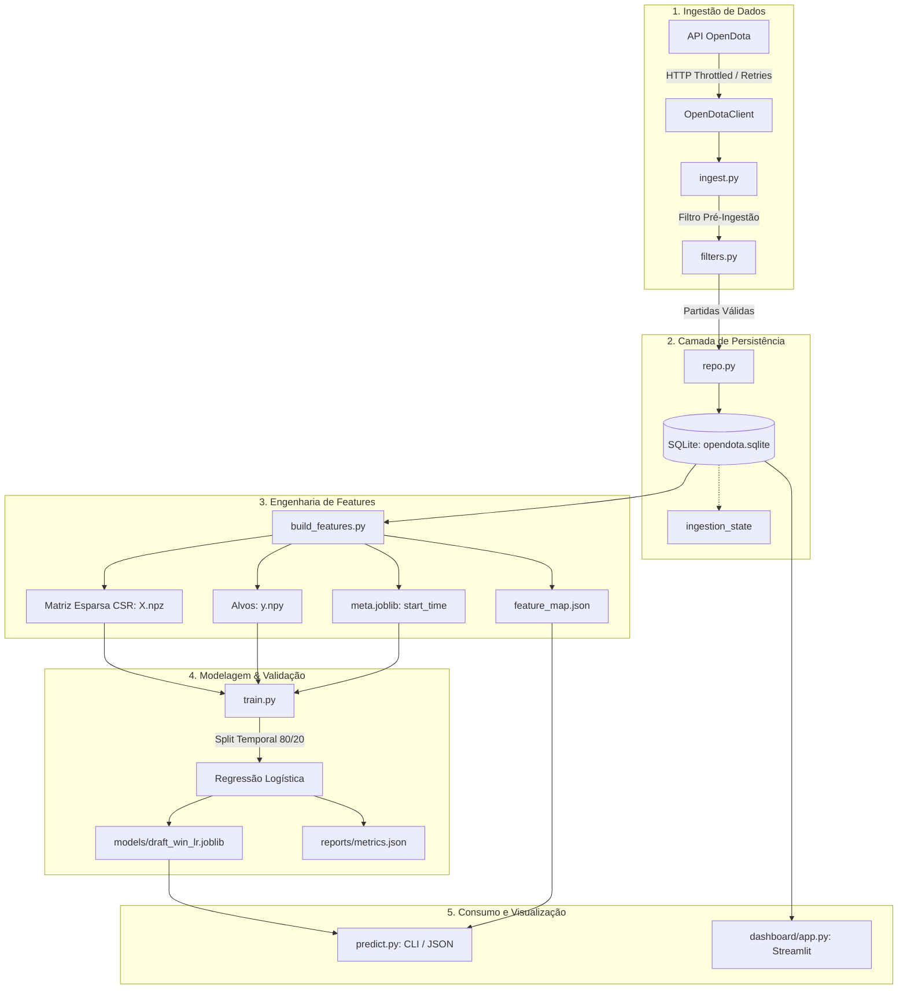

# Relatório de Análise Técnica e Arquitetural — Dota 2 Win Predictor (MVP)

Data da Análise: 2026-09-29  
Versão da Análise: 1.0  
Status do Projeto: MVP Operacional com Débitos Técnicos Identificados  

---

## 1. Visão Geral e Propósito

O **Dota 2 Win Predictor** é um sistema preditivo desenvolvido em Python projetado para estimar a probabilidade de vitória da equipe Radiant ($P(\text{Radiant Win})$) em partidas competitivas de Dota 2.

### Princípio Fundamental de Design: Anti-Leakage Estrito
A inferência é estritamente **pré-jogo** (ou seja, no encerramento da fase de draft).
* **Entradas permitidas no modelo:** Lado (Radiant vs. Dire), Heróis escolhidos (Picks), Heróis banidos (Bans) e ID do Patch.
* **Proibido no treinamento:** Métricas de desempenho intra-jogo (ouro por minuto, XP por minuto, abates, mortes, assistências, torres destruídas, itens comprados ou duração).

---

## 2. Diagrama de Arquitetura e Fluxo de Dados

---

## 3. Diagnóstico Componente a Componente

### 3.1. Configuração e Logging
* Arquivos: [`src/config.py`](file:///d:/Python%20Projetos/dota2req1/src/config.py), [`src/logger.py`](file:///d:/Python%20Projetos/dota2req1/src/logger.py)
* **Avaliação:** Adequada. As configurações são carregadas via `.env` utilizando `python-dotenv`. Possui validação básica de parâmetros (`OPENDOTA_RPS` e `PUBLICMATCHES_MIN_RANK`). O logger provê formatação uniforme com timestamp e nível.

### 3.2. Persistência e Banco de Dados (SQLite)
* Arquivos: [`src/db/schema.py`](file:///d:/Python%20Projetos/dota2req1/src/db/schema.py), [`src/db/repo.py`](file:///d:/Python%20Projetos/dota2req1/src/db/repo.py)
* **Tabelas Implementadas:**
  * `matches`: Armazena metadados da partida e resultado (`radiant_win`).
  * `draft_events`: Registra cada pick e ban associado à partida.
  * `match_players`: Metadados de jogadores (presença de abandonos `leaver_status`).
  * `ingestion_state`: Checkpoints incrementais por dataset (`pro`, `ranked_high`).
  * `hero_ref` e `patch_ref`: Tabelas de apoio.
* **Pontos Críticos Identificados:**
  * `upsert_match` trata conflitos de PK (`ON CONFLICT(match_id) DO UPDATE`), porém `insert_draft_events` e `insert_players` executam `INSERT` simples sem expurgo prévio. Reprocessar uma partida gera duplicação nas tabelas de eventos e jogadores.

### 3.3. Ingestão de Dados e OpenDota Client
* Arquivos: [`src/opendota/client.py`](file:///d:/Python%20Projetos/dota2req1/src/opendota/client.py), [`src/opendota/ingest.py`](file:///d:/Python%20Projetos/dota2req1/src/opendota/ingest.py), [`src/opendota/fetch_constants.py`](file:///d:/Python%20Projetos/dota2req1/src/opendota/fetch_constants.py)
* **Pontos Fortes:**
  * Throttling baseado em RPS evita bloqueio de IP.
  * Tratamento de HTTP 429 respeitando o cabeçalho `Retry-After`.
  * Backoff exponencial em respostas 5xx.
* **Volume Atual do Banco:**
  * 115 partidas profissionais coletadas.
  * 0 partidas de high rank público ingeridas até o momento.

### 3.4. Regras de Qualidade e Filtros
* Arquivo: [`src/features/filters.py`](file:///d:/Python%20Projetos/dota2req1/src/features/filters.py)
* **Regras de Negócio Estabelecidas:**
  1. `game_mode == 2` (Captain's Mode exclusivo).
  2. `duration >= 1800` (mínimo de 30 minutos).
  3. `picks_count == 10` (draft completo com 5 picks por equipe).
  4. `leaver_status == 0` para todos os 10 jogadores (ausência de abandonos).
* **Bug Crítico Encontrado:** Na linha 23 de `filters.py`, o código checa `if duration < 1300:` em vez de `if duration < 1800:`. Isso causa falha na suíte de testes unitários e aceita partidas de 21 minutos.

### 3.5. Engenharia de Features e Anti-Leakage
* Arquivos: [`src/features/build_features.py`](file:///d:/Python%20Projetos/dota2req1/src/features/build_features.py), [`src/features/dataset_stats.py`](file:///d:/Python%20Projetos/dota2req1/src/features/dataset_stats.py)
* **Estratégia:**
  * Mapeamento One-Hot Encoding esparso com prefixos:
    * `rad_pick_{hero_id}`, `dire_pick_{hero_id}`
    * `rad_ban_{hero_id}`, `dire_ban_{hero_id}`
    * `patch_{patch_id}`
  * Persistência otimizada com matrizes esparsas `scipy.sparse.csr_matrix` salvas em formato `.npz`.
  * Metadados temporais preservados em `meta.joblib` para o split cronológico.

### 3.6. Treinamento e Inferência
* Arquivos: [`src/model/train.py`](file:///d:/Python%20Projetos/dota2req1/src/model/train.py), [`src/model/predict.py`](file:///d:/Python%20Projetos/dota2req1/src/model/predict.py)
* **Modelo Atual:** `LogisticRegression(max_iter=1000, C=1.0, solver='lbfgs')`.
* **Métricas Registradas (`reports/metrics.json`):**
  * Amostras de Treino: 92 partidas
  * Amostras de Teste: 24 partidas
  * Log Loss de Treino: `0.1341`
  * Log Loss de Teste: `0.8032`
  * Acurácia de Teste: `62.50%`
* **Diagnóstico de ML:**
  * **Overfitting Significativo:** O abismo entre o treino ($0.13$) e o teste ($0.80$) comprova sobreajuste. Como o espaço de features possui centenas de dimensões e o treino dispõe de apenas 92 instâncias, a regressão logística decora correlações espúrias.

### 3.7. Interface de Usuário
* Arquivos: [`src/dashboard/app.py`](file:///d:/Python%20Projetos/dota2req1/src/dashboard/app.py), [`src/model/predict.py`](file:///d:/Python%20Projetos/dota2req1/src/model/predict.py)
* Dashboard funcional em Streamlit com KPIs de volume, winrate do Radiant, duração média, evolução temporal e barras com heróis mais escolhidos e banidos.
* CLI de predição aceita parâmetros diretos ou arquivo JSON, resolvendo nomes em inglês automaticamente.

### 3.8. Testes Automatizados
* Arquivos: [`tests/test_db_smoke.py`](file:///d:/Python%20Projetos/dota2req1/tests/test_db_smoke.py), [`tests/test_filters.py`](file:///d:/Python%20Projetos/dota2req1/tests/test_filters.py)
* **Resultado da Execução:** 1 falha em 5 testes (`test_short_duration`).
* **Vazamento no Banco:** `test_db_smoke.py` insere registros reais no banco de dados operacional `data/opendota.sqlite`, poluindo as estatísticas analíticas com dados de `smoke_test`.

---

## 4. Tabela de Riscos, Débitos Técnicos e Status de Resolução

| ID | Componente | Severidade | Descrição do Problema | Impacto | Status / Solução Aplicada |
| :--- | :--- | :--- | :--- | :--- | :--- |
| **BUG-01** | `src/features/filters.py` | **Alta** | Limiar de duração com valor 1300 em vez de 1800. | Falha de teste unitário e inclusão de partidas inválidas no dataset. | **RESOLVIDO**: Ajustado para `1800`. Testes unitários 100% OK. |
| **DEB-01** | `tests/test_db_smoke.py` | **Média** | O teste utilizava o banco operacional `opendota.sqlite` sem isolamento. | Poluição dos dados de treino e relatórios analíticos (`smoke_test`). | **RESOLVIDO**: Isolamento em banco temporário com teardown e remoção dos dados fake do SQLite principal. |
| **DEB-02** | `src/db/repo.py` | **Média** | `insert_draft_events` e `insert_players` não limpavam dados anteriores em reingestão. | Duplicação de registros em reexecuções parciais. | **RESOLVIDO**: Adicionado `DELETE FROM ... WHERE match_id = ?` garantindo idempotência estrita. |
| **FEAT-01**| `src/db/schema.py` & `repo.py` | **Média** | Ausência de captura de habilidade/MMR dos jogadores. | Impossibilidade de analisar disparidade de elo/MMR no draft. | **IMPLEMENTADO**: Adicionadas colunas `rank_tier` e `computed_mmr` em `match_players`. |
| **ML-01** | `src/model/train.py` | **Alta** | Volume de amostras insuficiente (92 partidas para centenas de features). | Severo sobreajuste (Log Loss Teste = 0.8032). | **PENDENTE**: Ingerir 5.000+ partidas e ajustar regularização ($C \le 0.1$). |
| **GOV-01** | Repositório | **Baixa** | Repositório Git não inicializado. | Ausência de versionamento e rastreabilidade de alterações. | **RESOLVIDO**: Repositório Git inicializado com `.gitignore` completo e commit inicial criado. |
| **GOV-02** | `requirements.txt` | **Baixa** | Dependências sem pinned versions (versões fixadas). | Quebras futuras por atualizações incompatíveis de dependências. | **RESOLVIDO**: Dependências fixadas com versões exatas instaladas. |

---

## 5. Próximos Passos Priorizados

1. **Sprint Corretiva Imediata:**
   * Corrigir o limiar em `src/features/filters.py`.
   * Isolar `tests/test_db_smoke.py` e remover a partida de teste `12345` do banco `data/opendota.sqlite`.
   * Adicionar cláusula de idempotência em `src/db/repo.py`.
   * Validar execução da suíte de testes com 100% de sucesso.
2. **Escala de Dados e Treinamento:**
   * Executar ingestão contínua para obter no mínimo 5.000 partidas (`pro` e `ranked_high`).
   * Reexecutar `build_features.py` e recalibrar hiperparâmetros de regularização do modelo.
3. **Controle de Versão:**
   * Inicializar o Git e registrar o baseline do projeto.
