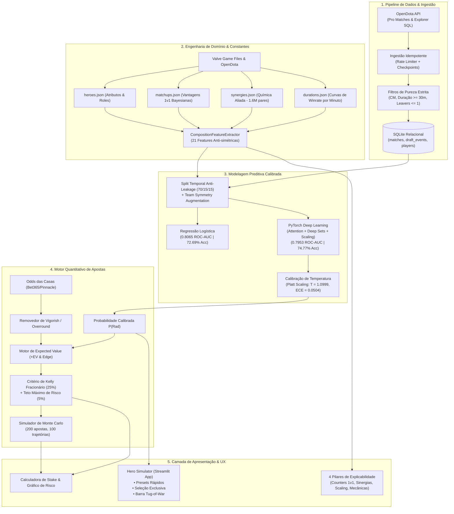
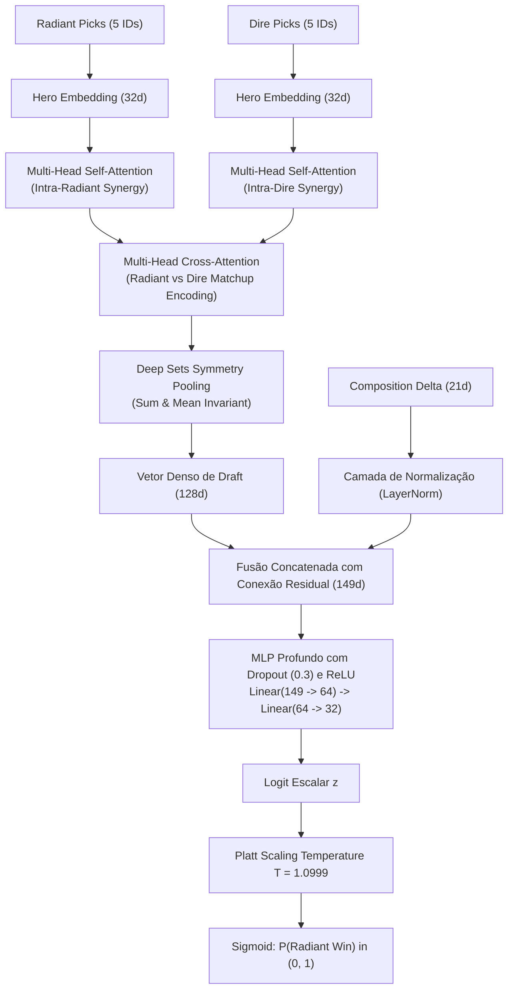

# 📐 Arquitetura do Sistema — Aegis Draft

Este documento descreve detalhadamente a arquitetura de software, engenharia de dados, modelagem matemática de Deep Learning e teoria dos jogos que compõem o sistema **Aegis Draft (Patch 7.41 / Patch 60)**.

---

## 1. Visão Geral da Arquitetura

O sistema é estruturado em cinco subsistemas desacoplados, projetados com foco em modularidade, reprodutibilidade, invariâncias matemáticas e baixa latência de inferência (< 50ms):

---

## 2. Subsistema de Dados & Ingestão (`src/opendota` e `src/db`)

### 2.1 Políticas de Pureza Estrita
A integridade preditiva do sistema depende da eliminação rigorosa de ruído e partidas atípicas:

1. **Modo de Jogo Exclusivo (`game_mode == 2`):**
   - Apenas o modo competitivo oficial **Captain's Mode** é aceito. Modos como All Pick ou Turbo possuem dinâmicas causais completamente distintas.
2. **Duração Mínima ($\ge 1800$ segundos / 30 minutos):**
   - Elimina partidas encerradas precocemente por desistência, desconexões massivas ou bugs.
3. **Draft Completo e Válido:**
   - Exige exatamente 10 heróis únicos selecionados (5 Radiant e 5 Dire). Drafts com picks faltantes ou heróis repetidos são descartados.
4. **Política de Leavers e Desconexões:**
   - Jogadores com `leaver_status >= 2` (abandono deliberado ou AFK) invalidam a partida.
   - Jogadores com `leaver_status == 1` (*Disconnected* sem abandono formal) são tolerados para preservar partidas competitivas encerradas via comando "GG" antes da destruição formal do Ancient.
5. **Isolamento de Patch (`target_patch == 60`):**
   - Partidas de patches anteriores são rejeitadas para evitar anacronismos táticos e balanceamentos defasados.

### 2.2 Esquema Relacional e Persistência Atômica
O banco relacional local (`data/opendota.sqlite`) implementa integridade referencial e idempotência através de transações ACID:
* **`matches`:** Metadados da partida (`match_id`, `radiant_win`, `start_time`, `duration`, `patch_id`, `game_mode`).
* **`draft_events`:** Sequência cronológica de escolhas e banimentos (`match_id`, `is_pick`, `hero_id`, `team`, `order`).
* **`players`:** Desempenho e status de abandono (`match_id`, `player_slot`, `hero_id`, `leaver_status`).

---

## 3. Subsistema de Engenharia de Features (`src/features/composition_features.py`)

O extrator gera um vetor denso de **21 features de composição**, desenhado para capturar todas as dimensões táticas do Dota 2 sob duas garantias matemáticas invioláveis:

### 3.1 Garantias Matemáticas Formais

1. **Invariância à Permutação (Ordem de Seleção):**
   Para qualquer permutação $\pi$ da ordem em que os heróis foram escolhidos na equipe:
   $$\vec{v}_{\text{team}}(\pi(h_1, h_2, h_3, h_4, h_5)) = \vec{v}_{\text{team}}(h_1, h_2, h_3, h_4, h_5)$$
   *Garantido através de operações comutativas de agregação (média, soma, mínimo e máximo).*

2. **Antissimetria Estrita (Inversão de Lados):**
   $$\Delta(\text{Dire}, \text{Radiant}) = -\Delta(\text{Radiant}, \text{Dire})$$
   *Garante que inverter os times inverte perfeitamente o sinal do vetor delta, impedindo viés posicional artificial de Radiant ou Dire.*

3. **Padronização RMS sem Subtração de Média:**
   O escalonador `CompositionScaler` normaliza as features dividindo estritamente pelo desvio quadrático médio amostral:
   $$\tilde{\Delta} = \frac{\Delta}{\text{RMS}(\Delta)} \implies \widetilde{-\Delta} = -\tilde{\Delta}$$
   *(A subtração de média clássica violaria a antissimetria, introduzindo assimetrias espúrias).*

---

### 3.2 As 21 Features de Composição e Domínio

| Índice | Nome da Feature | Dimensão Conceitual | Descrição Matemática & Técnica |
| :---: | :--- | :--- | :--- |
| `0` | `cooldown_mean` | Teamfight Pacing | Cooldown médio de todas as habilidades ativas dos 5 heróis. |
| `1` | `long_cd_count` | Decisive Ult Spikes | Quantidade de habilidades com cooldown $\ge 100$s (Ravage, Black Hole). |
| `2` | `spammer_count` | Sustained Damage | Quantidade de magias de spam constante (cooldown $\le 6$s). |
| `3` | `base_health` | EHP Inicial | Vida inicial somada da equipe (força base $\times 22$ + base). |
| `4` | `base_mana` | Capacidade de Conjurador | Mana inicial somada da equipe (inteligência base $\times 12$ + base). |
| `5` | `attribute_gain` | Escalonamento Físico | Ganho somado de atributos por nível de todos os 5 heróis. |
| `6` | `move_speed` | Mobilidade de Mapa | Velocidade base de movimento média dos heróis. |
| `7` | `turn_rate` | Reatividade em Lutas | Taxa de rotação média da equipe. |
| `8` | `initiator_count` | Capacidade de Engage | Número de heróis classificados oficialmente com o papel *Initiator*. |
| `9` | `durable_count` | Capacidade de Frontline | Número de heróis classificados com o papel *Durable*. |
| `10` | `carry_overlap` | Ganância de Recursos | Penalidade de atrito: $\max(0, N_{\text{Carries}} - 2)$. |
| `11` | `bkb_pierce_count`| Mecânica Anti-Spell Immunity | Habilidades que penetram Debuff Immunity (BKB) na equipe. |
| `12` | `strong_dispel_count`| Limpeza de Controle | Habilidades com Strong Dispel (remove stuns, ex: Press the Attack, Aphotic Shield). |
| `13` | `hard_save_count` | Sobrevivência Crítica | Habilidades de salvamento absoluto (ex: Shallow Grave, Disruption, False Promise). |
| `14` | `avg_synergy` | Coesão Coletiva | Média das sinergias empíricas dos $\binom{5}{2} = 10$ pares de aliados. |
| `15` | `max_synergy` | Combo Decisivo | Maior sinergia individual entre uma dupla da equipe. |
| `16` | `min_synergy` | Atrito Máximo | Menor sinergia (maior anti-sinergia) entre uma dupla da equipe. |
| `17` | `early_power` | Força Pré-30 Min | Taxa média de vitória da equipe em partidas com duração $\le 30$ minutos. |
| `18` | `late_power` | Força Pós-45 Min | Taxa média de vitória da equipe em partidas com duração $> 45$ minutos. |
| `19` | `scaling_factor` | Inclinação de Escalonamento | Diferencial de potência: $\text{late\_power} - \text{early\_power}$. |
| `20` | `matchup_advantage`| Vantagem H2H Líquida | Balanço dos 25 confrontos individuais 1v1 entre Radiant e Dire. |

---

## 4. Modelagem Preditiva & Inteligência Artificial

O projeto utiliza dois paradigmas de modelagem complementares:

### 4.1 Regressão Logística Calibrada (Interpretabilidade e Benchmark)
* **Entrada:** 509 features One-Hot de Picks/Bans esparsos concatenadas com as 21 features densas de composição.
* **Regularização:** Ridge ($L_2$, $C=0.10$).
* **Métricas no Teste:** **0.8065 ROC-AUC** | **72.69% Acurácia** | **Log Loss: 0.5375** | **Brier Score: 0.1803**.
* **Interpretabilidade dos Coeficientes:**
  - `matchup_advantage` (+1.6394): O sinal preditivo mais potente de todo o modelo.
  - `scaling_factor` (+0.2036): Times com maior poder de late game são altamente valorizados.
  - `avg_synergy` (+0.1165): A química do elenco protege a taxa de vitória contra drafts desarticulados.

---

### 4.2 Rede Neural Profunda PyTorch (`DotaWinPredictorNN`)

Projetada com uma arquitetura dedicada para conjuntos não-ordenados (*Deep Sets*) e atenção cruzada:

#### Especificações Técnicas:
* **Dimensão do Embedding:** 32 por herói (treinado do zero end-to-end).
* **Mecanismo de Atenção:** 4 cabeças de Self-Attention e 4 cabeças de Cross-Attention com dropout residual.
* **Calibração Pós-Treino (Platt Temperature Scaling):**
  $$P(\text{Radiant Win}) = \sigma\left(\frac{z}{T}\right)$$
  Com $T = 1.0999$, o modelo corrige o excesso de confiança e reduz o Erro de Calibração Esperado para **$ECE = 0.0504$**.
* **Métricas no Teste:** **74.77% de Acurácia** | **0.7953 ROC-AUC** | **Log Loss: 0.5510** | **Brier Score: 0.1844**.

---

## 5. Subsistema Quantitativo de Teoria dos Jogos & Apostas (`src/betting`)

O módulo quantitativo converte as probabilidades do modelo preditivo em tomadas de decisão financeiras com proteção estocástica de capital:

### 5.1 Dedução do Vigorish (Overround)
As casas de apostas embutem uma comissão implícita em suas cotações:
$$\text{Overround} = \frac{1}{O_{\text{Rad}}} + \frac{1}{O_{\text{Dire}}} - 1$$
O motor normaliza as probabilidades para eliminar essa margem artificial e obter as **probabilidades justas de mercado ($P_{fair}$)**:
$$P_{fair, \text{Rad}} = \frac{1 / O_{\text{Rad}}}{\frac{1}{O_{\text{Rad}}} + \frac{1}{O_{\text{Dire}}}}$$

### 5.2 Valor Esperado (+EV) e Edge
$$+EV = (P_{\text{modelo}} \times \text{Odd}) - 1, \quad \text{Edge} = P_{\text{modelo}} - P_{fair}$$
* **Trava de Segurança:** Apenas oportunidades com $+EV \ge +3.0\%$ (ou $+5.0\%$) acionam recomendação de aposta, blindando a estratégia contra ruído de amostragem.

### 5.3 Critério de Kelly Fracionário
O Critério de Kelly maximiza o crescimento logarítmico do capital no longo prazo:
$$f^* = \frac{P \times O - 1}{O - 1} = \frac{+EV}{O - 1}$$
* **Ajuste Fracionário (Quarter Kelly — 25%):**
  $$f_{\text{alocada}} = \min(0.25 \times f^*, 0.05)$$
  *Garante ~85% da taxa de retorno teórico do Kelly cheio, reduzindo o drawdown máximo e a volatilidade da banca em mais de 75%.*
* **Teto Prudencial:** Nenhuma aposta pode ultrapassar **5% da banca total**. Se $+EV \le 0$, a aposta é estritamente **R$ 0,00**.

### 5.4 Simulação de Monte Carlo
O motor estocástico simula $N = 200$ apostas consecutivas em $M = 100$ universos paralelos:
* Mensura o **Drawdown Máximo Mediano** esperado.
* Calcula o **Risco de Ruína** (probabilidade de a banca sofrer uma contração superior a 50% de seu pico).
* Gera as curvas de projeção de patrimônio exibidas interativamente no Streamlit.

---

## 6. Camada de Apresentação (Streamlit Dashboard)

O arquivo [`src/dashboard/app.py`](src/dashboard/app.py) foi projetado com os seguintes princípios de UX:
1. **Hero Section Imediata:** O simulador de draft ocupa o topo da aplicação. O usuário não precisa navegar por páginas para obter o valor principal.
2. **Seleção Exclusiva de Heróis:** Previne que o mesmo herói seja escolhido simultaneamente por Radiant e Dire.
3. **Placar Visual Tug-of-War:** Barra proporcional animada contrastando verde (#10b981) e vermelho (#ef4444).
4. **Os 4 Pilares de Explicabilidade:**
   - ⚔️ **Counters 1v1:** Vantagem líquida e Top 3 duelos decisivos.
   - 🤝 **Química Aliada:** Melhores combos e maiores pontos de atrito da equipe.
   - ⏱️ **Relógio de Jogo:** Força relativa no Early vs Late e veredito de quem está "no relógio".
   - 🛡️ **Mecânicas de Combate:** Contagem e listagem de BKB-Pierces, Strong Dispels e Hard Saves.
5. **Calculadora Quantitativa Integrada:** Formulário de odds em tempo real com projeção de stake e gráficos estocásticos de Monte Carlo.
