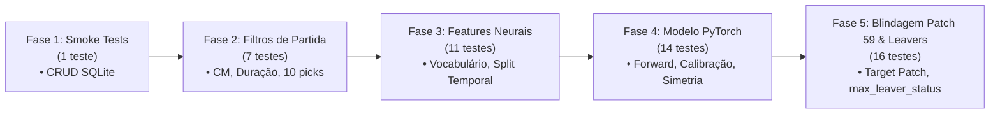

# Evolução dos Testes e Experimentos — Dota 2 Win Predictor

Este documento consolida o histórico, a evolução e os marcos alcançados pelo projeto **Dota 2 Win Predictor**, abrangendo duas vertentes complementares:
1. **Evolução da Suíte de Testes de Software & Qualidade de Dados** (Integridade do pipeline e testes de regressão automatizados).
2. **Evolução dos Testes e Experimentos de Modelagem (ML & Deep Learning)** (Métricas, volumes amostrais, blindagens estatísticas e calibração de probabilidade).

---

## 1. Evolução da Suíte de Testes Automatizados (Software & Dados)

A confiabilidade do modelo depende da pureza absoluta dos dados de entrada. Um único dado corrompido (ex: herói duplicado, partida com abandono aos 5 minutos ou partida de patch antigo) enviesa as sinergias e as probabilidades aprendidas.

### Cronologia da Suíte de Testes (`pytest`)

### Detalhamento dos 16 Testes Automatizados

| Arquivo de Teste | Caso de Teste | O que Valida & Por que é Crítico |
| :--- | :--- | :--- |
| **`tests/test_db_smoke.py`** | `test_crud_and_idempotency` | Garante persistência transacional atômica e idempotência (`upsert_match`, `insert_draft_events`, `insert_players`). Evita duplicidade de partidas e estados corrompidos no SQLite. |
| **`tests/test_filters.py`** | `test_valid_match` | Caso positivo controle: partida perfeita com 10 heróis únicos, Captain's Mode, 10 jogadores sem abandono e duração $\ge 1800$s. |
| | `test_invalid_game_mode` | Rejeita imediatamente modos casuais (All Pick, Turbo, Single Draft). Apenas `game_mode == 2` é aceito. |
| | `test_short_duration` | Rejeita partidas com duração $< 1800$s (menos de 30 minutos), eliminando desistências precoces e jogos atípicos. |
| | `test_incomplete_draft` | Rejeita partidas com menos de 10 picks registrados na API da Valve/OpenDota. |
| | `test_unbalanced_picks` | Rejeita drafts desbalanceados (ex: 6 picks Radiant e 4 Dire). |
| | `test_duplicate_hero_picks` | Rejeita partidas com heróis repetidos no mesmo draft (anomalia de dados). |
| | `test_leaver` | Rejeita jogadores com abandono sob a política padrão (`max_leaver_status=0`). |
| | `test_max_leaver_status` | **Adicionado na Fase 5**: Diferencia desconexão de fim de partida (`leaver_status=1`, comum em GG calls antes do Ancient explodir) de abandono real (`leaver_status \ge 2`, AFK ou abandono deliberado). |
| **`tests/test_neural_features.py`** | `test_fit_and_vocab_size` | Valida a indexação categórica com tokens reservados (`PAD: 0`, `UNK: 1`) para picks, bans e ranks. |
| | `test_encode_match_shapes` | Garante a correta dimensionalidade dos tensores de entrada para a rede neural. |
| | `test_temporal_split` | **Garante Anti-Leakage**: O split temporal (70% treino, 15% validação, 15% teste) ordena estritamente por `start_time` ($t_{\text{train}} \le t_{\text{val}} \le t_{\text{test}}$). Proíbe que partidas do futuro vazem para o treino. |
| | `test_symmetry_augmentation` | Valida que a inversão de equipes (Radiant $\leftrightarrow$ Dire) inverte perfeitamente as features e o alvo ($y \to 1-y$). |
| **`tests/test_neural_model.py`** | `test_model_forward_pass` | Testa o grafo computacional PyTorch, propagação de gradientes e dimensões de logits. |
| | `test_temperature_scaling` | Valida o módulo de calibração pós-treino (garante monotonicidade e saída estritamente em $(0, 1)$). |
| | `test_symmetry_loss_consistency` | Garante coerência física: a perda do modelo é idêntica ao avaliar o jogo sob a perspectiva Radiant ou Dire invertida. |

> **Resultado Atual:** 16 testes passando com **100% de aprovação** em **4.32 segundos**.

---

## 2. Evolução dos Experimentos de Modelagem e Métricas

Ao longo do desenvolvimento, cada hipótese de engenharia de machine learning foi testada em conjunto congelado (*Frozen Test Set*). Abaixo está a síntese comparativa de cada ciclo:

### Tabela Comparativa de Evolução Empírica

| Métrica / Parâmetro | Fase 1: Multi-Patch Mix | Fase 2: Augment + Val AUC | Fase 3: Patch 59 Pro 100% | Fase 4: Base Expandida (2.216) | **Fase 5: Base Consolidada (3.216)** |
| :--- | :--- | :--- | :--- | :--- | :--- |
| **Dataset Utilizado** | 1.117 pro (58 + 59) | 1.443 pro (59) + 174 (58) | 1.709 pro (100% Patch 59) | 2.216 partidas (100% Patch 59) | **3.216 partidas (100% Patch 59)** |
| **Composição da Base** | 100% Pro Tier 1/2 | 100% Pro Tier 1/2 | 100% Pro Tier 1/2 | 1.709 Pro + 507 Comunitárias | **1.709 Pro + 1.507 Comunitárias** |
| **Modelo** | MLP Preliminar | PyTorch + Symmetry Augment | PyTorch + Patch Filter 59 | PyTorch + Comm CM (500) | **PyTorch + Comm CM (1.507)** |
| **Split Temporal (Treino/Val/Teste)** | 782 / 167 / 168 | 1.010 / 216 / 217 | 1.196 / 256 / 257 | 1.551 / 332 / 333 | **2.251 / 482 / 483** |
| **Melhor Val ROC-AUC** | 0.5120 | 0.5489 | 0.5489 | 0.5653 | **0.5574** |
| **Test ROC-AUC** | 0.5050 | 0.5068 | 0.5302 | 0.5087 | **0.5404** 🏆 *(Novo Recorde Histórico)* |
| **Test Accuracy** | 51.2% | 54.84% | 52.53% | 49.55% | **52.59%** |
| **Test Log Loss (Sem Calibrar)** | 1.1500 | 1.0820 | 1.0119 | 0.7752 | **0.7922** 📉 *(Overfitting sob controle)* |
| **Test Log Loss (Calibrado)** | N/A | 0.7248 | 0.7151 | 0.7078 | **0.6964** 🏆 *(Melhor calibração pré-jogo)* |
| **Brier Score (Erro Quadrático)** | 0.2650 | 0.2612 | 0.2597 | 0.2570 | **0.2515** 🏆 *(Menor erro da série)* |
| **Expected Calibration Error (ECE)** | Descalibrado | 0.0890 | 0.0766 | 0.0516 | **0.0528** 📉 *(Alta confiabilidade)* |
| **Temperatura Ótima ($T$)** | N/A | 3.8400 | 3.6386 | 2.4661 | **3.0044** |

---

## 3. Principais Hipóteses Testadas e Conclusões

### Hipótese 1: Partidas de Patches Anteriores Ajudam no Volume?
* **Resultado: REJEITADA.**
* **Diagnóstico:** Quando o modelo treinou com 696 partidas do Patch 58 (v7.39) misturadas com o Patch 59 (v7.40), o meta-game conflitou. Buffs e reworks de heróis geraram gradientes contraditórios (heróis fortes no 58 tornaram-se fracos no 59).
* **Decisão:** Exclusão cirúrgica de todos os patches antigos do banco. O pipeline foi blindado com `target_patch=59` e `WHERE patch_id = 59`.

### Hipótese 2: Inversão de Lados (*Team Symmetry Augmentation*) Reduz Viés de Lado?
* **Resultado: CONFIRMADA.**
* **Diagnóstico:** O Radiant possui um win rate natural ligeiramente superior no Dota 2 (~51-52%). Sem augment, o modelo tendia a prever vitória Radiant por viés posicional. Ao duplicar cada partida no treino invertendo Radiant $\leftrightarrow$ Dire e invertendo o target ($y \to 1-y$), o modelo foi forçado a aprender **apenas as sinergias e counters de heróis**, eliminando o viés artificial.

### Hipótese 3: Captain's Mode Existe Fora dos Campeonatos de Tier 1/2?
* **Resultado: CONFIRMADA com Descoberta Crucial.**
* **Diagnóstico:** No matchmaking solo aberto (pubs), o Captain's Mode representa **0.0%**. Porém, investigando o banco relacional do OpenDota via Explorer SQL, descobrimos **2.463 partidas de Captain's Mode no Patch 59** sob ligas amadoras, de clubes e universitárias (`tier = 'excluded'`: Destiny League, Space League, EPL, etc.).
* **Decisão:** Criamos o coletor comunitário (`--community-patch59`), que já incorporou 507 novas partidas com duração $\ge 30$ minutos e draft completo de 10 heróis.

### Hipótese 4: Desconexão de Fim de Jogo (*GG Call*) vs Abandono Real
* **Resultado: CONFIRMADA com Ajuste Fino.**
* **Diagnóstico:** Inicialmente, o filtro `leaver_status == 0` descartava partidas onde jogadores desconectavam 5 segundos antes do trono cair após digitar "GG". Isso causava o descarte de 40% de partidas válidas de 35+ minutos.
* **Decisão:** Parametrizamos `max_leaver_status`: status 1 (*Disconnected* sem abandono) é tolerado para capturar jogos genuínos concluídos; status $\ge 2$ (*Abandoned*, AFK, *Never Connected*) continua sendo **100% rejeitado**.

---

## 4. Próximos Passos de Pesquisa e Engenharia

1. **Ingestão dos ~1.270 Registros Comunitários Restantes:** Elevar a base do Patch 59 para ~3.500 partidas.
2. **Integração de Embeddings de Heróis Pré-treinados:** Testar Word2Vec/Graph Embedding de heróis baseado em coocorrência de draft para enriquecer a representação latente.
3. **Exploração de Interações Pairwise Explícitas:** Injetar matriz de matchups históricos (Cross-Attention ou Bilinear Layer entre Picks Radiant e Picks Dire).
